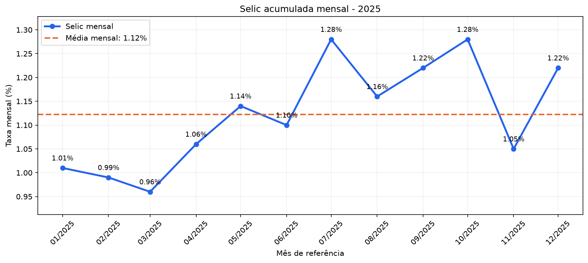

# 📈 Análise do Mercado Financeiro com SQL e Python

### Análise de indicadores econômicos utilizando dados históricos reais

Projeto de Análise de Dados desenvolvido com Python, Pandas, PostgreSQL, SQL e Matplotlib, com foco na coleta, organização, exploração e visualização de dados financeiros.

O primeiro estudo analisa a **Selic acumulada mensal em 2025**, utilizando informações oficiais do Banco Central do Brasil.

## 📊 Visualização dos dados



*Fonte: Banco Central do Brasil — Série SGS 4390. Elaboração própria com Python e Matplotlib.*

## 📌 Sobre o projeto

Este projeto tem como objetivo transformar dados financeiros históricos em informações úteis para análise e interpretação.

A proposta é desenvolver progressivamente um ambiente de análise que permita investigar indicadores econômicos, comparar comportamentos históricos e comunicar resultados por meio de consultas SQL, cálculos estatísticos e visualizações.

O projeto integra diferentes etapas do trabalho com dados:

- Coleta de informações de fontes oficiais.
- Tratamento e padronização com Python e Pandas.
- Armazenamento em banco de dados PostgreSQL.
- Consultas e análises utilizando SQL.
- Construção de indicadores estatísticos.
- Desenvolvimento de visualizações com Matplotlib.
- Documentação de resultados e limitações.

O desenvolvimento busca aplicar conhecimentos relevantes para a atuação profissional em **Análise de Dados**, especialmente no setor financeiro.

## 🎯 Objetivos

### Objetivo principal

Desenvolver análises fundamentadas em dados históricos do mercado financeiro, utilizando ferramentas de programação, bancos de dados e estatística para produzir indicadores e visualizações.

### Objetivos específicos

- Trabalhar com dados reais e fontes verificáveis.
- Desenvolver habilidades em SQL e PostgreSQL.
- Utilizar Python para coleta e preparação de dados.
- Aplicar Pandas na manipulação de informações financeiras.
- Construir gráficos e relatórios analíticos.
- Identificar padrões e variações históricas.
- Aplicar estatística descritiva.
- Desenvolver boas práticas de documentação e versionamento.
- Construir um portfólio técnico reproduzível.

## 💡 Motivação

Meu interesse pelo mercado financeiro começou ainda na adolescência, quando abri minha primeira conta em uma corretora com autorização da minha mãe. Desde então, passei a estudar investimentos, ações e diferentes produtos financeiros, desenvolvendo curiosidade sobre o funcionamento do mercado e a relação entre risco e retorno.

A tecnologia também sempre despertou meu interesse. Desde criança, gostava de desmontar objetos para compreender como funcionavam e descobrir a lógica por trás deles.

Ao ingressar na faculdade de Análise e Desenvolvimento de Sistemas, encontrei na área de dados uma oportunidade de unir esses dois interesses.

Este projeto nasceu dessa combinação: utilizar programação e análise de dados para investigar informações financeiras reais, desenvolver meu raciocínio analítico e construir soluções baseadas em evidências.

---

## 🔎 Estudo 01 — Selic acumulada mensal em 2025

### Problema de análise

Como a Selic acumulada mensal se comportou durante 2025?

Para responder a essa pergunta, foram coletados e analisados os 12 registros mensais da série SGS 4390, disponibilizada pelo Banco Central do Brasil.

A análise busca identificar:

1. A média das taxas mensais observadas.
2. Os maiores e menores valores registrados.
3. Os meses com valores acima da média.
4. As variações entre meses consecutivos.
5. Os períodos de maior aumento e maior redução do indicador mensal.

### Fonte de dados

**Instituição:** Banco Central do Brasil  
**Sistema:** Sistema Gerenciador de Séries Temporais (SGS)  
**Série:** 4390 — Selic acumulada no mês  
**Período analisado:** Janeiro a dezembro de 2025  
**Quantidade de registros:** 12

API utilizada:

https://api.bcb.gov.br/dados/serie/bcdata.sgs.4390/dados?formato=json&dataInicial=01/01/2025&dataFinal=31/12/2025

**Importante:** a série 4390 representa a Selic acumulada no mês. Ela não deve ser confundida com a taxa Selic meta anual definida pelo Copom.

## 📈 Resultados encontrados

### Indicadores gerais

| Indicador | Resultado |
|---|---:|
| Meses analisados | 12 |
| Média aritmética mensal | 1,12% |
| Maior valor mensal | 1,28% |
| Menor valor mensal | 0,96% |
| Meses acima da média | 6 |
| Maior aumento entre meses consecutivos | +0,18 p.p. |
| Maior redução entre meses consecutivos | -0,23 p.p. |

### Evolução mensal

| Mês | Selic acumulada mensal | Variação em relação ao mês anterior |
|---|---:|---:|
| Janeiro | 1,01% | — |
| Fevereiro | 0,99% | -0,02 p.p. |
| Março | 0,96% | -0,03 p.p. |
| Abril | 1,06% | +0,10 p.p. |
| Maio | 1,14% | +0,08 p.p. |
| Junho | 1,10% | -0,04 p.p. |
| Julho | 1,28% | +0,18 p.p. |
| Agosto | 1,16% | -0,12 p.p. |
| Setembro | 1,22% | +0,06 p.p. |
| Outubro | 1,28% | +0,06 p.p. |
| Novembro | 1,05% | -0,23 p.p. |
| Dezembro | 1,22% | +0,17 p.p. |

### Principais observações

**1. Maiores valores mensais**

Julho e outubro apresentaram os maiores valores da série analisada, ambos com Selic acumulada mensal de 1,28%.

**2. Menor valor mensal**

Março apresentou o menor valor do período, com 0,96%.

**3. Meses acima da média**

Maio, julho, agosto, setembro, outubro e dezembro apresentaram valores superiores à média aritmética mensal de aproximadamente 1,12%.

**4. Maior aumento entre meses consecutivos**

A maior variação positiva ocorreu de junho para julho, quando o valor passou de 1,10% para 1,28%, uma diferença de +0,18 ponto percentual.

**5. Maior redução entre meses consecutivos**

A maior variação negativa ocorreu de outubro para novembro, quando o indicador passou de 1,28% para 1,05%, uma redução de 0,23 ponto percentual.

### Interpretação dos resultados

Os dados mostram oscilações na Selic acumulada mensal ao longo de 2025.

Apesar de seis meses apresentarem valores acima da média, isso não significa que o indicador tenha aumentado continuamente nesses períodos.

Por exemplo, agosto apresentou valor acima da média anual dos registros mensais, mas inferior ao registrado em julho.

Essa diferença demonstra a importância de separar duas análises:

- Comparação de um valor com a média do período.
- Comparação de um valor com o mês imediatamente anterior.

As conclusões apresentadas são descritivas e se limitam à série e ao período selecionados.

---

## 🛠️ Tecnologias utilizadas

| Tecnologia | Aplicação |
|---|---|
| Python | Coleta, tratamento e visualização de dados |
| Pandas | Manipulação de DataFrames e tratamento de datas e valores |
| Requests | Consulta à API do Banco Central |
| PostgreSQL | Armazenamento dos registros financeiros |
| SQL | Consultas, agregações e análises temporais |
| Matplotlib | Construção e exportação de gráficos |
| CSV | Armazenamento intermediário e transferência de dados |
| Git | Controle de versão |
| GitHub | Publicação e documentação |
| VS Code | Desenvolvimento do projeto |

## 🗂️ Estrutura do projeto

```text
analise-mercado-financeiro/
│
├── README.md
├── .gitignore
├── selic_2025.csv
│
├── sql/
│   ├── 01_estrutura.sql
│   ├── 02_dados_selic.sql
│   └── 03_relatorio_selic_2025.sql
│
├── notebooks/
│   ├── 01_exploracao_selic.py
│   ├── 02_coleta_selic.py
│   └── 03_grafico_selic.py
│
└── graficos/
    └── selic_2025.png
```

### Descrição das pastas

**`sql/`**

Contém scripts de criação da estrutura do banco de dados, inserção inicial e consultas financeiras.

**`notebooks/`**

Contém scripts Python utilizados para exploração, coleta, tratamento e visualização dos dados.

Embora a pasta tenha esse nome, os arquivos atuais são scripts `.py`, e não notebooks Jupyter `.ipynb`.

**`graficos/`**

Armazena as imagens geradas pelas análises.

**`selic_2025.csv`**

Contém os 12 registros tratados da Selic acumulada mensal em 2025.

**`README.md`**

Apresenta o projeto, metodologia, tecnologias, resultados e instruções de reprodução.

---

## ⚙️ Como executar o projeto

### Pré-requisitos

- Python 3.
- PostgreSQL.
- Git.
- Bibliotecas Python: `pandas`, `requests` e `matplotlib`.

Os comandos abaixo devem ser executados no terminal, a partir da pasta principal do projeto.

### 1. Clonar o repositório

```bash
git clone https://github.com/LucasCompton00/analise-mercado-financeiro.git

cd analise-mercado-financeiro
```

### 2. Criar e ativar um ambiente virtual

No macOS ou Linux:

```bash
python3 -m venv .venv

source .venv/bin/activate
```

### 3. Instalar as dependências

```bash
python -m pip install pandas requests matplotlib
```

### 4. Coletar e preparar os dados

```bash
python notebooks/02_coleta_selic.py
```

O script consulta os dados da API do Banco Central, realiza transformações com Pandas e gera o arquivo CSV.

O repositório também contém uma cópia de `selic_2025.csv`, permitindo reproduzir as análises sem realizar uma nova consulta à API.

### 5. Preparar o PostgreSQL

Crie um banco de dados chamado `laboratorio_dados`, caso ele ainda não exista:

```bash
createdb laboratorio_dados
```

Execute o script de estrutura:

```bash
psql -d laboratorio_dados -f sql/01_estrutura.sql
```

Esse script cria o esquema `mercado_financeiro` e a tabela `selic_mensal`.

O arquivo `sql/02_dados_selic.sql` contém a inserção inicial de janeiro de 2025, utilizada durante o desenvolvimento.

Para inserir esse registro inicial, execute:

```bash
psql -d laboratorio_dados -f sql/02_dados_selic.sql
```

### 6. Importar os 12 meses para o PostgreSQL

Abra o PostgreSQL:

```bash
psql -d laboratorio_dados
```

Crie uma tabela temporária para receber os dados:

```sql
CREATE TEMP TABLE selic_importacao (
    data_referencia DATE,
    taxa_percentual NUMERIC(6,4)
);
```

Importe o CSV:

```sql
\copy selic_importacao FROM 'selic_2025.csv' WITH (FORMAT csv, HEADER true);
```

Transfira os registros para a tabela definitiva:

```sql
INSERT INTO mercado_financeiro.selic_mensal
    (data_referencia, taxa_percentual)
SELECT
    data_referencia,
    taxa_percentual
FROM selic_importacao
ON CONFLICT (data_referencia) DO NOTHING;
```

O `ON CONFLICT` impede que datas já existentes sejam inseridas novamente.

Esse procedimento deve ser realizado na mesma sessão do PostgreSQL, pois a tabela temporária é válida apenas durante essa sessão.

### 7. Executar o relatório SQL

Saia do console interativo do PostgreSQL com `\q` e execute no terminal:

```bash
psql -P pager=off -d laboratorio_dados -f sql/03_relatorio_selic_2025.sql
```

O relatório apresenta:

- Indicadores gerais da Selic mensal.
- Meses com valores acima da média.
- Variações entre meses consecutivos.

As consultas atuais consideram o conjunto de dados de 2025 armazenado na tabela.

### 8. Gerar o gráfico

Com o ambiente virtual ativado:

```bash
python notebooks/03_grafico_selic.py
```

O script utiliza o CSV tratado para gerar a visualização.

O gráfico é salvo em:

```text
graficos/selic_2025.png
```

---

## 🔬 Metodologia

O processo de análise foi organizado nas seguintes etapas.

### 1. Extração

Coleta dos registros mensais por meio da API pública do Banco Central.

### 2. Transformação

Utilização do Pandas para:

- Converter textos em valores numéricos.
- Padronizar datas.
- Renomear colunas.
- Preparar o conjunto de dados para armazenamento e análise.

### 3. Carregamento

Importação dos registros para o PostgreSQL, utilizando tabela temporária e tratamento de conflitos de chave primária.

### 4. Análise exploratória

Consultas SQL para calcular médias, valores máximos e mínimos, filtros e variações mensais.

### 5. Visualização

Construção de um gráfico de linha com Matplotlib, incluindo:

- Valores mensais.
- Identificação dos meses.
- Linha de média.
- Rótulos numéricos.
- Legendas e identificação dos eixos.

### 6. Documentação

Organização dos scripts, resultados, visualizações e explicações neste repositório.

---

## ⚠️ Limitações da análise

Este estudo utiliza apenas os 12 registros mensais de 2025.

A série SGS 4390 corresponde à **Selic acumulada no mês**, não à taxa Selic meta anual.

A média de 1,12% representa a média aritmética dos 12 valores mensais, e não a taxa efetiva acumulada do ano.

As diferenças entre meses foram calculadas em pontos percentuais.

As análises não permitem, isoladamente, estabelecer relações de causalidade entre a Selic e outros indicadores econômicos.

Os resultados apresentados têm finalidade educacional e analítica.

## 🚧 Status do projeto

**Em desenvolvimento — primeira análise financeira funcional.**

### Etapas concluídas

- [x] Definição do tema.
- [x] Criação do repositório GitHub.
- [x] Configuração do ambiente Python.
- [x] Configuração inicial do PostgreSQL.
- [x] Criação do esquema e da tabela SQL.
- [x] Coleta de dados oficiais do Banco Central.
- [x] Tratamento dos registros com Pandas.
- [x] Exportação dos dados para CSV.
- [x] Importação para o PostgreSQL.
- [x] Tratamento de duplicidades na carga inicial.
- [x] Consultas SQL para análise da Selic.
- [x] Cálculo de variações mensais.
- [x] Criação do gráfico com Matplotlib.
- [x] Publicação dos scripts e do gráfico no GitHub.

### Próximas melhorias

- [ ] Automatizar a carga de dados no PostgreSQL.
- [ ] Ampliar o período histórico analisado.
- [ ] Implementar validações adicionais de qualidade dos dados.
- [ ] Criar novos indicadores estatísticos.
- [ ] Analisar séries econômicas adicionais.
- [ ] Comparar indicadores financeiros e econômicos.
- [ ] Construir um dashboard interativo.
- [ ] Criar documentação para execução automatizada do projeto.

## 📚 Aprendizados desenvolvidos

Durante a construção do projeto, foram praticados conceitos como:

- SQL: `SELECT`, `WHERE`, `GROUP BY`, `HAVING`, funções de agregação, subconsultas e CTEs.
- SQL analítico: funções de janela, incluindo `LAG()`.
- Banco de dados: esquemas, tabelas, chaves primárias e importação de registros.
- Python: bibliotecas, variáveis, funções e estruturas de repetição.
- Pandas: DataFrames, conversão de tipos, leitura e exportação de CSV.
- Matplotlib: gráficos de linha, legendas, anotações e exportação de imagens.
- Git e GitHub: commits, versionamento e publicação.
- Interpretação de indicadores econômicos.

## 🌐 Fontes e referências

- [Banco Central do Brasil — Dados Abertos](https://dadosabertos.bcb.gov.br/)
- [Banco Central do Brasil — Sistema Gerenciador de Séries Temporais](https://www3.bcb.gov.br/sgspub/)
- [Documentação oficial do Pandas](https://pandas.pydata.org/docs/)
- [Documentação oficial do PostgreSQL](https://www.postgresql.org/docs/)
- [Documentação oficial do Matplotlib](https://matplotlib.org/stable/)

---

## ⚖️ Aviso

Este projeto possui finalidade educacional e de desenvolvimento profissional.

As análises são baseadas em dados históricos e não representam recomendações personalizadas de investimento.

Resultados passados não garantem desempenhos futuros.

---

**Projeto desenvolvido como parte da formação em Análise e Desenvolvimento de Sistemas, com foco em Análise de Dados aplicada ao mercado financeiro.**
